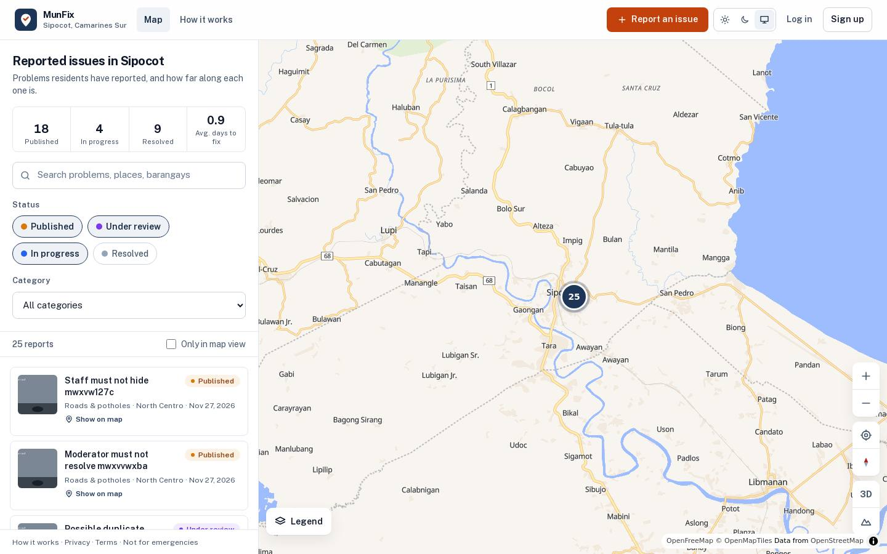
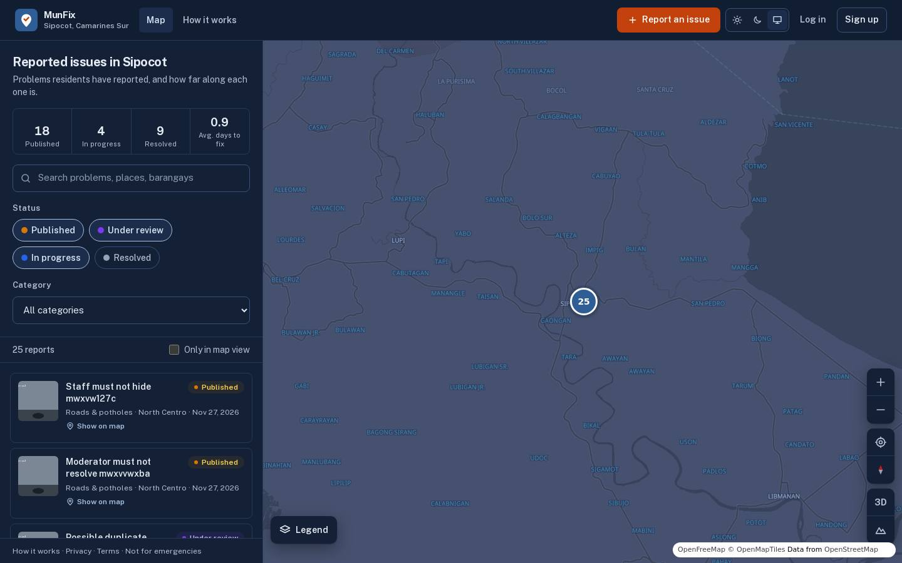
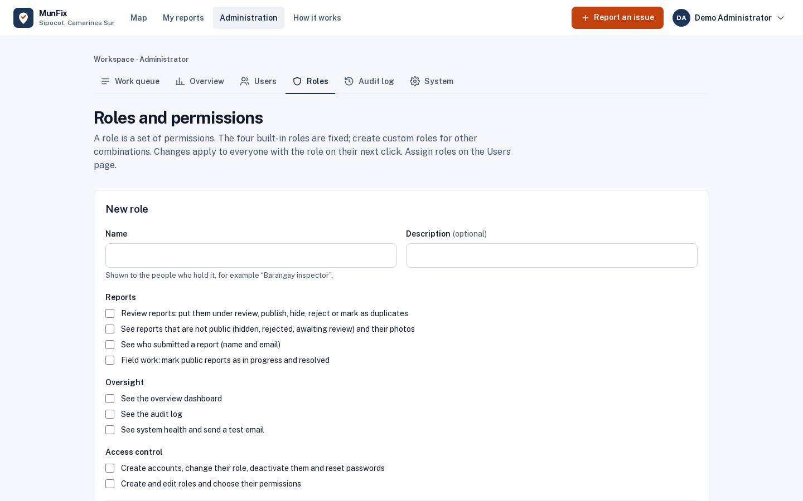
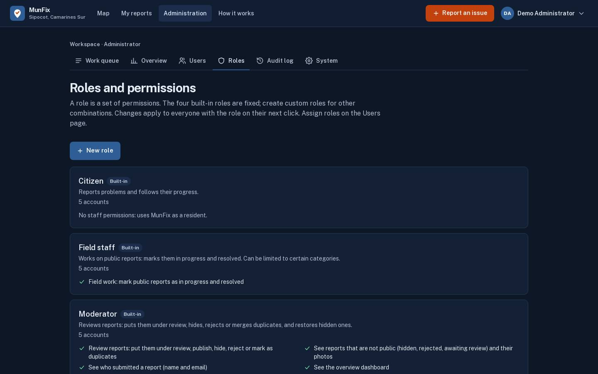
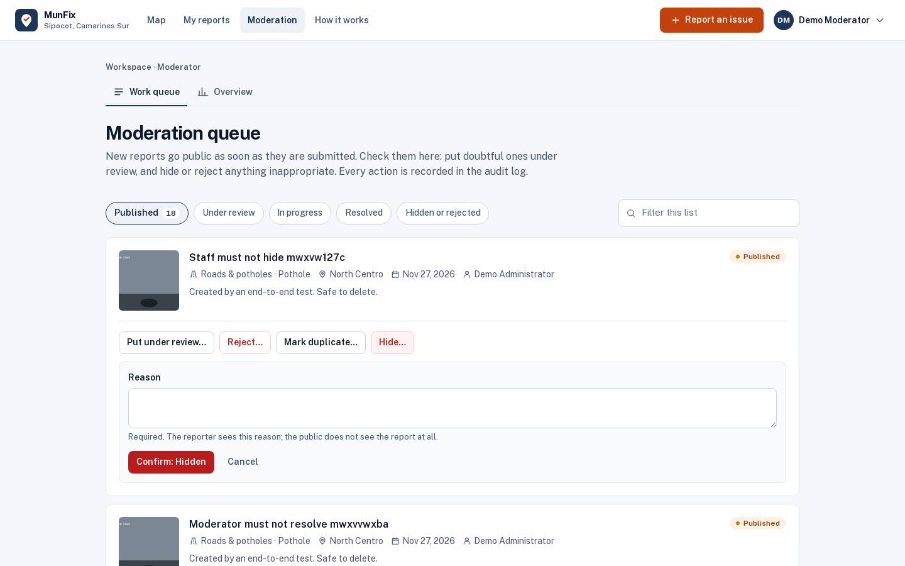
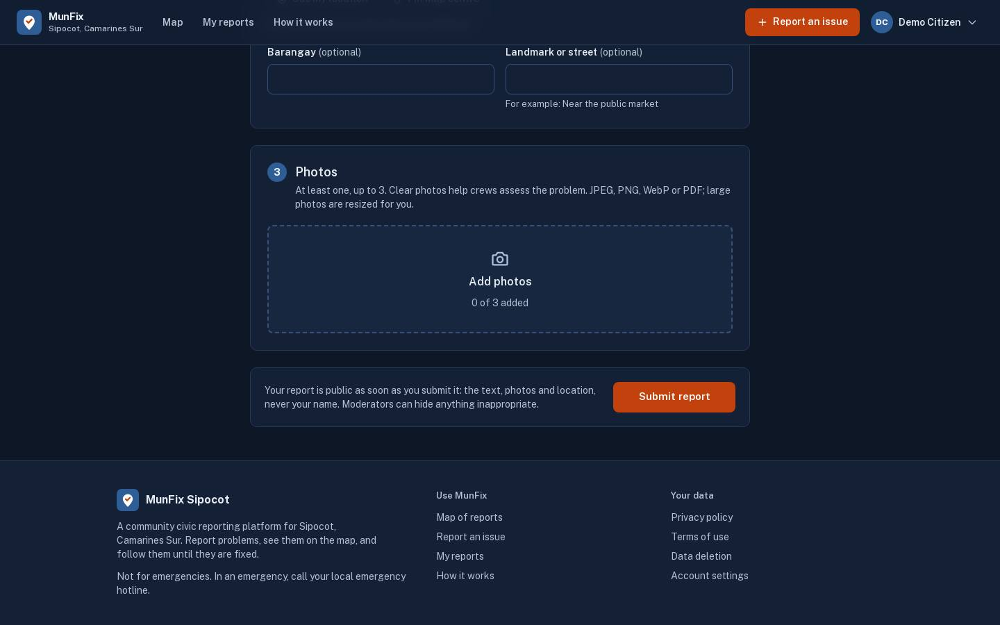
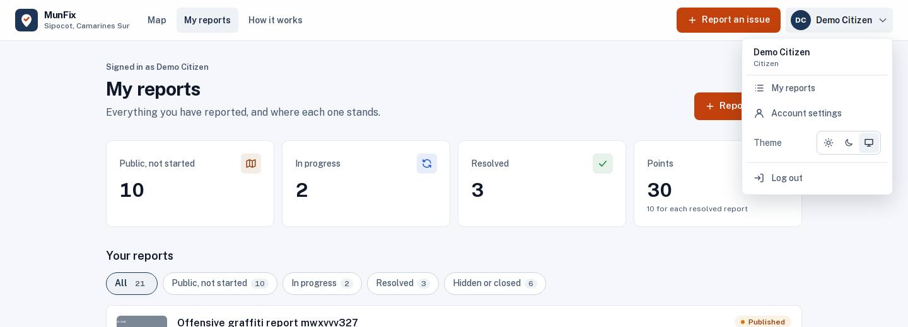
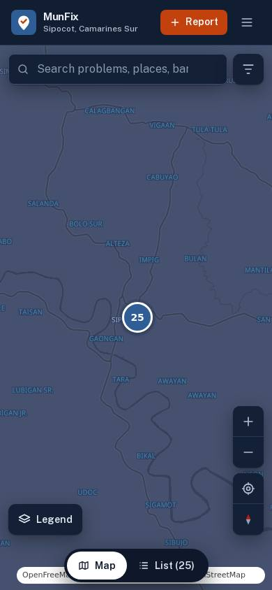

# MunFix additional enhancements — November 2026

Branch `claude/munfix-additional-enhancements`, based on `main` after PRs #14 and #15 were merged. Nothing was merged or deployed.

## 1. Summary

| # | Requirement | Result |
| --- | --- | --- |
| 1 | Playwright | Added to the repository (`e2e/`, `playwright.config.ts`) and to CI. Covers every route and role, desktop, tablet and phone, plus Firefox and WebKit in CI. Traces and screenshots are kept on failure. **199 tests pass locally**; the email and cross-browser tests run in CI (§6) |
| 2 | Marker hover | Root cause found and fixed: hovering scaled the marker element that MapLibre positions, which also scaled its map offset, so markers jumped. Covered by a CSS invariant test and browser tests at several zoom levels |
| 3 | Mailpit | Docker Compose service (localhost only), development SMTP settings, documentation, and end-to-end email tests in CI. Email and in-app notifications are clearly separated: MunFix has email only |
| 4 | Roles | Permission-based authorization. 4 built-in roles with unchanged behaviour, custom roles managed by administrators, server-side enforcement, escalation guards, tests |
| 5 | Dark mode | Light, Dark and System, applied before first paint, through semantic design tokens. 0 axe violations in either theme; the map has its own dark style |
| 6 | Map tiles | `tile.openstreetmap.org` removed. Default is OpenFreeMap vector tiles (free, no key), configurable, with a fallback that needs no third party |
| 7 | Auto-publication | Reports are public when submitted. New Hidden status, Under review kept public, moderation and audit trail kept, privacy reviewed |
| 8 | Test accounts | One per role, development and CI only: never created on a non-local URL, and refused at login anywhere else. `docs/testing-accounts.md` |
| 9 | Documentation | README, `.env.example`, Docker Compose, and new docs: testing, testing accounts, roles and permissions, Mailpit, map tiles. Architecture, security and operations docs updated |

## 2. Features and changes

### 2.1 Automatic publication (backend, database, frontend)

- **Database (migration 007):**
  - adds the `hidden` status;
  - makes `verified` the default status for new reports;
  - moves reports that were still waiting for their first review (`under_review` and never published) to `submitted`.

  Those reports were filed under the promise that staff check them first, so none of them becomes public retroactively; a moderator decides.
- **Backend:**
  - `createReport` inserts `status = 'verified'` and `published_at = now()`, with a matching audit event and email.
  - The visibility rules in `lib/status.ts` are now: public is `verified` (labelled **Published**), `under_review`, `in_progress` and `resolved`; private is `submitted`, `hidden`, `rejected`, `duplicate` and `withdrawn`.
  - New transitions: any public report can be hidden; a hidden report can be restored (published).
  - Hide and Reject require a reason, which the reporter sees.
  - The public timeline only shows events after publication.
- **Reporter edits:** reporters can now edit until work starts (before, only while `submitted`, which no longer happens). Because the report is already public, each edit is written to the audit log as `edited` and refreshes the public caches.
- **Frontend:**
  - The queue tabs are Published, Under review, In progress, Resolved, and Hidden or rejected. Actions are Put under review, Publish, Hide, Reject and Mark duplicate.
  - The progress tracker shows Published, then In progress, then Resolved.
  - The map's default filters include Under review.
  - Every sentence that promised review before publication was rewritten: the report form, About, the auth panel, My reports, the privacy policy and the terms. The form says plainly that the report is public at once and that the reporter's name never is.
- **Emails:** new messages for published, under review, hidden and restored.

### 2.2 Roles and permissions

- **Permission catalogue** (`lib/permissions.ts`): `reports.review`, `reports.view_private`, `reports.view_reporter`, `reports.work`, `stats.view`, `audit.view`, `system.view`, `users.manage`, `roles.manage`.
- **Built-in roles** (Citizen, Field staff, Moderator, Administrator) reproduce the earlier behaviour exactly. A test pins each role's abilities. They are fixed: seeded by migration 007 and re-synced from code on start.
- **Enforcement on the server:**
  - `requirePermission()` (API) and `requirePagePermission()` (pages, which answer 404 when access is missing).
  - Report visibility, transitions, the reporter identity and the category scope all depend on permissions, not role names.
  - Permissions are read from the database on every request, so edits and disabling take effect immediately.
- **Custom roles:** Admin → Roles lets an administrator create, rename and describe roles, choose permissions, enable or disable them, and see each role's permissions and account count. Users get them on Admin → Users. API: `GET/POST /api/v1/admin/roles` and `PATCH /api/v1/admin/roles/:key`.
- **Escalation guards** (`lib/roles.ts`, `lib/users.ts`):
  - nobody can grant, create, edit, assign or act on access they do not hold;
  - built-in roles are fixed;
  - nobody can edit or disable their own role, or change their own role;
  - the last administrator cannot be demoted or deactivated;
  - every change is audited.

  Details: [roles-and-permissions.md](roles-and-permissions.md).
- **Public timeline credit** now depends on whether the actor's role has any permission. Before, it depended on the role not being "citizen", which would have exposed the names of people on a custom role with no permissions.

### 2.3 Dark mode

- **Tokens:** `app/globals.css` defines semantic tokens once per theme: surface, foreground, line, accent, primary, focus, chart, and the danger, warning and success tones. A migration script moved every component from raw palette utilities (`bg-white`, `text-slate-600`, `bg-red-50`, …) to these tokens. The only fixed colours left are surfaces that are dark in both themes: the photo viewer, toasts and the phone's map/list toggle.
- **The dark palette** is the brand's ink navy turned down, not a grey-black, so the product keeps its character at night. Status badge text has its own dark shades (`STATUS_TEXT_DARK`).
- **No flash:** a tiny inline script in `<head>` resolves Light, Dark or System before first paint, follows OS changes while System is selected, and the choice is stored in this browser (`localStorage`). The switcher sits in the header (signed out), the account menu (signed in) and the phone menu. It is a native radio group, so the arrow keys work.
- **Map:** the basemap switches to OpenFreeMap "fiord" in dark mode without recreating markers. Map controls, popups and attribution use the theme tokens.

### 2.4 Map marker hover (bug fix)

MapLibre positions each marker by setting `transform: translate(x, y)` on its root element. The cluster's hover style set `scale: 1.08` on that same element. CSS applies individual transform properties *before* `transform`, so the scale also multiplied the map offset. Hovering a cluster moved it by about 8% of its distance from the map's top-left corner, and on a large map that is tens of pixels. The fix:

- The marker root never changes transform or size. Hover, focus and pressed styles act on an inner disc (`.cluster-disc`) or the pin drawing (`.pin-svg`), so the hit area never moves under the pointer.
- Numbers are centred with grid layout and tabular figures. Counts over 999 are abbreviated ("1.2k"); the accessible label keeps the exact count.
- A hovered or focused marker is raised above its neighbours.
- Keyboard and touch work: markers are buttons, Enter zooms into a cluster, tap opens a pin's preview, and there is a visible focus ring.
- **Tests:**
  - a unit test fails if any CSS rule ever transforms or resizes a marker root;
  - browser tests compare bounding boxes before and after hover and focus, check that the number is centred, and cover keyboard and tap, at several zoom levels;
  - viewports: desktop, tablet and phone, and Firefox and WebKit in CI.

### 2.5 Map tiles

Default basemap: OpenFreeMap "liberty" (light) and "fiord" (dark). It is free, has no API key, uses OpenStreetMap data and keeps the required attribution. It is configurable through `NEXT_PUBLIC_MAP_STYLE_URL`, `NEXT_PUBLIC_MAP_STYLE_URL_DARK`, or a raster `NEXT_PUBLIC_MAP_TILE_URL`. If the style fails or takes more than 8 s, the map switches to a plain background, so pins and reporting still work. The evaluation of OpenFreeMap, self-hosted tiles, MapTiler, Stadia and Carto, plus licensing and deployment notes, is in [map-tiles.md](map-tiles.md).

### 2.6 Mailpit and notifications

- `docker-compose.yml`: `axllent/mailpit:v1.34`, SMTP `127.0.0.1:1025`, web UI `127.0.0.1:8025`, and a health check. `npm run services:up` starts it. The Compose `full` profile points the app at it.
- `.env.example`: `SMTP_HOST=localhost`, `SMTP_PORT=1025` for development, with production providers documented separately. Real values live only in the git-ignored `.env` or the hosting environment.
- **Notifications review:** MunFix has **no in-app notifications**, only email (status changes, password reset, test email). Registration sends no email, because there is no address verification (still the audit's O1). [mailpit.md](mailpit.md) explains the difference and what in-app notifications would take.

### 2.7 Test accounts

`demo.citizen@`, `demo.staff@`, `demo.moderator@` and `demo.admin@munfix.local`, all with password `demo-password`, for development only.

- They are reset to a known state (role, active, password) on every start or seed.
- They are created only when `APP_URL` is a localhost address (`isLocalEnvironment()`; a Vercel production deployment never counts).
- The login route refuses them on any other deployment.

This replaces the earlier rule, which allowed them in production with a strong `DEMO_PASSWORD`. [testing-accounts.md](testing-accounts.md) has the URLs, permissions and reset steps.

### 2.8 Other fixes made along the way

- Restricted workspace pages now answer **HTTP 404**, not a streamed 200 showing the 404 page. The admin `loading.tsx` was making Next.js send the status before the permission check ran.
- **WCAG 2.5.3 (Label in name):** the logo link and the pager buttons had `aria-label`s that did not contain their visible text, so voice-control users could not activate them by what they see. The labels were removed; the visible text is the name.
- Role keys keep accented letters readable ("Peñafrancia" becomes "penafrancia", not "pen-afrancia").
- The README claimed the seed script creates demo logins with `demo-password`. It never did (its sample accounts get random passwords). Corrected.

## 3. Database changes

`db/migrations/007_roles_and_publication.sql`:

- creates `roles` with the four built-in roles;
- replaces `users_role_check` with a foreign key to `roles.key`;
- replaces `reports_status_check` to add `hidden`;
- sets `reports.status` to default to `verified`;
- runs `UPDATE reports SET status = 'submitted' WHERE status = 'under_review' AND published_at IS NULL`.

It is additive. It was checked on a fresh database (CI) and on a database with existing data, where existing users kept their roles, the one pending report stayed private, and published reports were unchanged. Rollback notes: [operations.md](operations.md).

## 4. Security considerations

- **Authorization stays authoritative on the server.** The UI only mirrors the rules, to explain why a control is unavailable. Every rule has unit tests and end-to-end tests against the real API.
- **No privilege escalation** through roles or user management (§2.2); there are dedicated tests for user-manager, role-manager and self-promotion attempts.
- **Disabling a role** removes its access on the next request. Sessions do not carry permissions.
- **Auto-publication is a deliberate exposure trade-off.** Content is public before anyone checks it. Reporter identity is still never public. Hiding immediately removes the report and its photos from public view, although shared caches may keep a photo for up to 5 minutes. Edits are audited, and the 10-reports-per-hour limit stays. See [security.md](security.md) item 8.
- **Test accounts** cannot exist or work on a real deployment (§2.7).
- **Mailpit** is bound to localhost and documented as development-only. Production SMTP settings are never in the repository.
- **Dependencies:**
  - new dev dependencies only: `@playwright/test` 1.64.1 and `@axe-core/playwright` 4.14.0;
  - `npm audit --omit=dev`: 0 vulnerabilities;
  - the 3 dev-only Vitest advisories noted in the first audit remain (the Vitest upgrade is still pending).

## 5. Screenshots

| | |
| --- | --- |
| Map, light  | Map, dark (OpenFreeMap fiord)  |
| Roles: new role form  | Roles, dark  |
| Moderation: hide with a required reason  | Report form, dark: "public as soon as you submit"  |
| Theme switcher in the account menu  | Phone, dark  |

## 6. Tests and results

| Check | Result |
| --- | --- |
| `npm run typecheck` | exit 0 |
| `npm test` (Vitest) | **13 files, 187 passed** (119 before this branch) |
| `npm run build` | compiled successfully. Shared first-load JS unchanged at 103 kB |
| `npm audit --omit=dev --audit-level=high` | 0 vulnerabilities |
| `npm run test:e2e`, run locally (Chromium: setup, desktop, tablet, mobile; production build; PostgreSQL 17; a local Redis stand-in) | **199 passed, 5 skipped**: the 4 email tests (no Mailpit locally, see below) and the keyboard-only cluster test on the phone profile |
| Accessibility (axe-core, WCAG 2.2 AA tags), part of the run above | 16 pages × light and dark × desktop and phone: **0 violations** |
| Lint | No linter is configured in this repository; not run |
| CI (`check` and `e2e` jobs, including Firefox, WebKit and Mailpit) | See the pull request's checks |

**New tests:**

- **Unit:** escalation guards and role management (`roles.test.ts`); the built-in role matrix (`permissions.test.ts`); the publication state machine (`status.test.ts`); auto-publish, hiding, disabled roles and temporary passwords (`report-access.test.ts`); dark and light token contrast and the marker CSS invariant (`design-system.test.ts`); cluster labels and sizes; test-account guards.
- **End-to-end:** `public`, `map`, `auth`, `citizen`, `moderation`, `admin`, `authorization`, `email` and `a11y` specs.

**Not verified here:**

- **Email.** Mailpit could not run in this environment: there is no Docker, and running its downloaded binary was not permitted. The email tests run only in CI, against a Mailpit service container.
- **Firefox and WebKit.** Their system libraries are missing here, so they run only in CI. If a CI browser has no WebGL, the map tests skip with that reason rather than fail.

## 7. Known limitations and outstanding work

| Item | Notes |
| --- | --- |
| In-app notifications | Not implemented; email only. They need a table, an API and a UI ([mailpit.md](mailpit.md)) |
| Email verification at sign-up | Still missing (audit O1): registration sends no email, and OAuth linking can be pre-hijacked |
| "Assigned work" for field staff | Field staff see their categories' public reports; there is no per-report assignment. That needs an `assigned_to` column and an assignment endpoint |
| Custom roles cannot be deleted | Only disabled, so accounts and audit history stay consistent. Role keys never change |
| Theme preference | Stored per browser, not per account. Without JavaScript the light theme is used whatever the OS preference |
| Auto-publication | Inappropriate content is public until a moderator acts; consider image screening or a per-category "review first" option if abuse appears |
| OpenFreeMap | No SLA; the documented fallbacks are self-hosting or a keyed provider |
| CI duration | The e2e job adds about 10 to 15 minutes; tests run serially (`workers: 1`) because they share one database |
| Vitest advisories (dev only) | Upgrade to Vitest 4.1.12 or later in a separate PR |

## 8. Rollout

1. Merge after review. Vercel builds; migration 007 runs on first start (`AUTO_SETUP`).
2. Check `/api/health`, log in as an administrator, and open Admin → Roles (four built-in roles) and Admin → Users (roles unchanged).
3. Submit a test report as a resident and confirm it is public at once. As a moderator, hide it and restore it.
4. Check the map in light and dark mode and the attribution.
5. Make sure `SEED_DEMO_ACCOUNTS` is not set in production; it would be ignored anyway.
