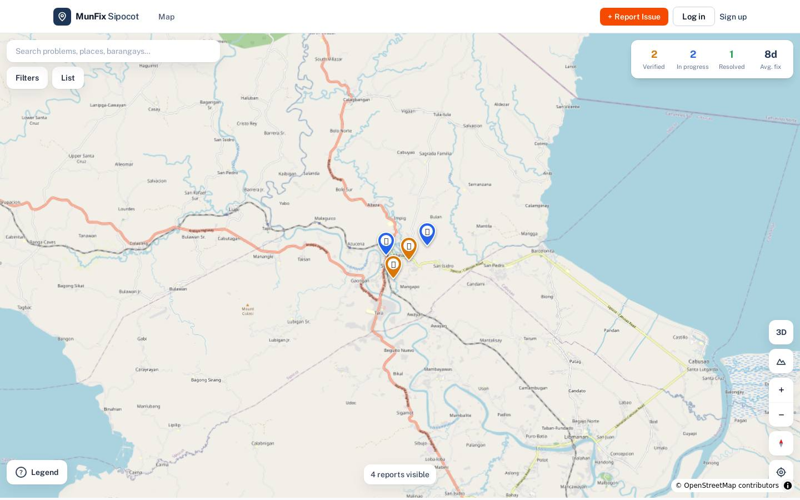
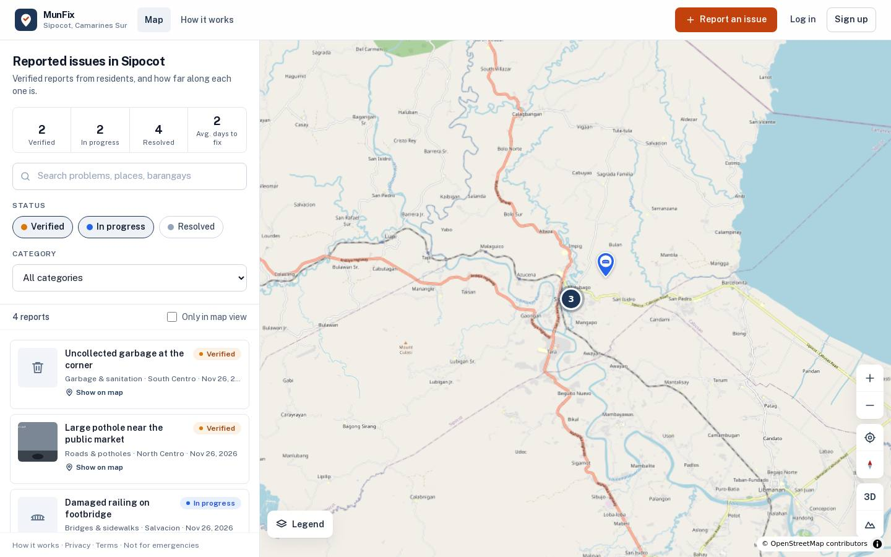
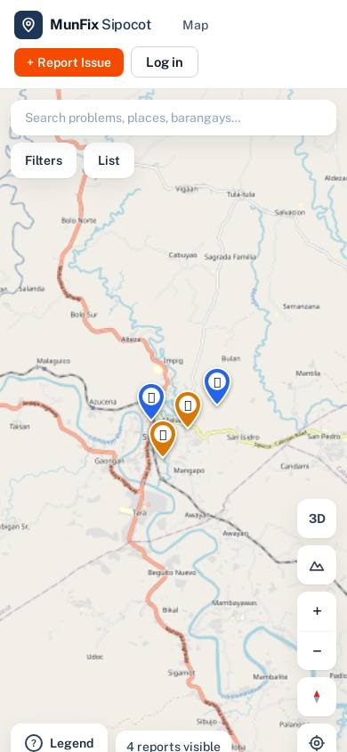
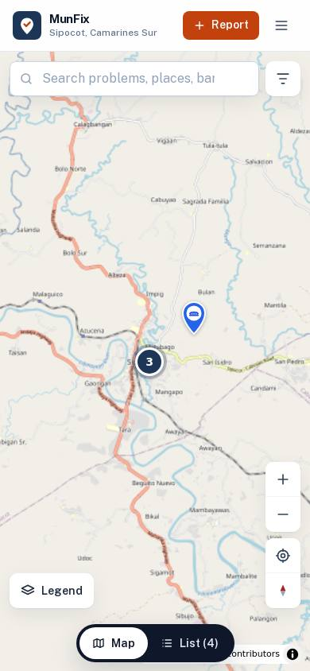
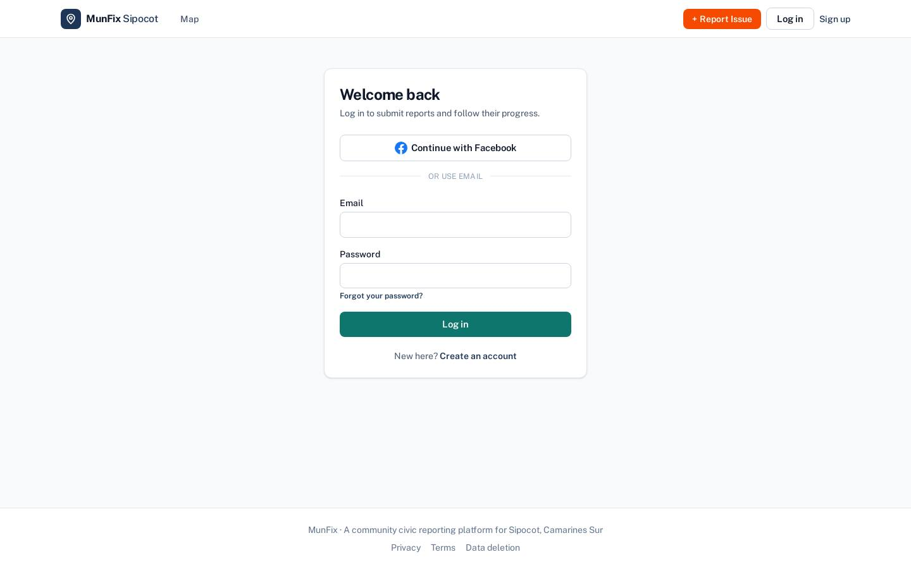
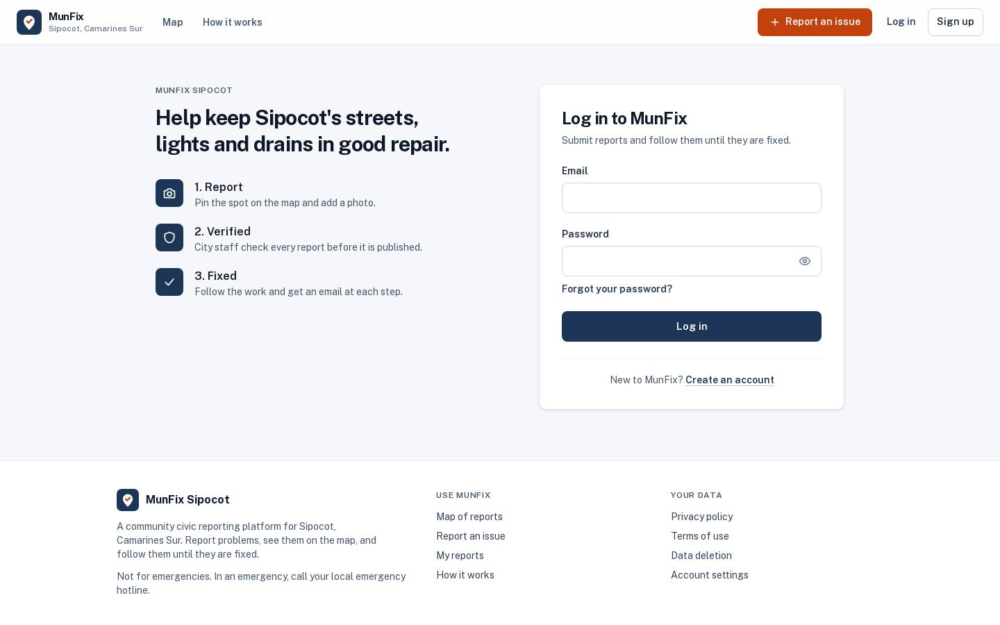
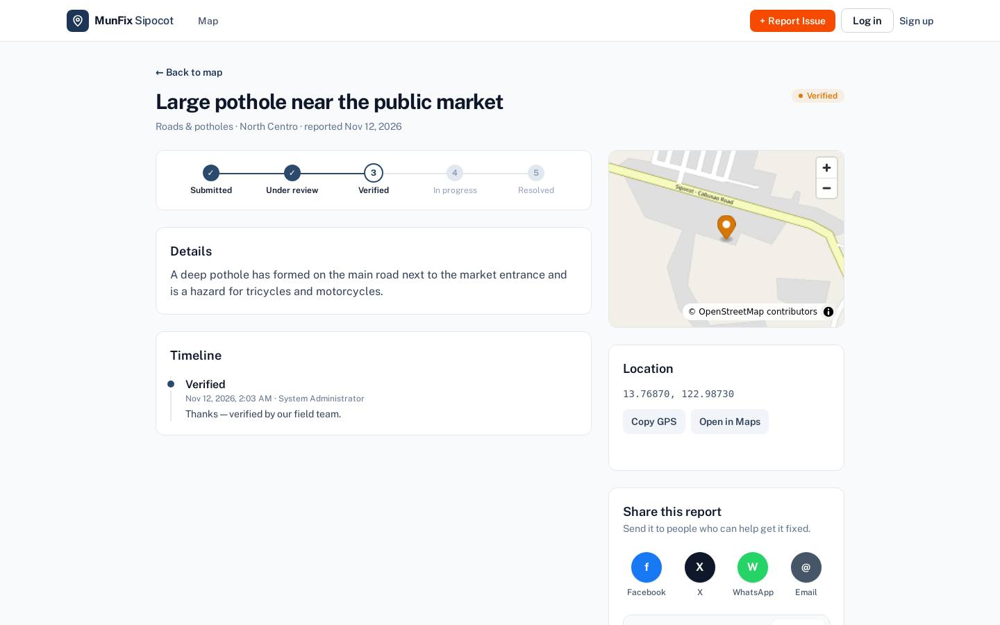
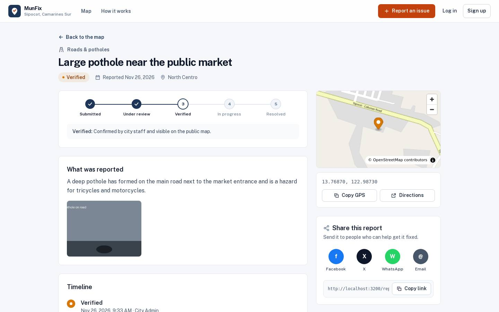

# MunFix frontend enhancement — November 2026

Branch `claude/munfix-frontend-enhancement`. It is stacked on `claude/munfix-fullstack-audit` (PR #14), because both change the explorer, report form and location picker. Until #14 merges, the PR for this branch also shows #14's single commit.

## 1. Summary

Every frontend route was reviewed and rebuilt on one shared design system:

- the public map and list
- report pages
- authentication
- the citizen portal
- the moderator, field-staff and administrator workspace
- informational pages
- error, empty and loading states

**What did not change:**

- No API contract, authentication rule or authorization rule changed.
- There are no database migrations.
- No mock data was added to any page.

**One backend change:** a one-line fix to `npm run db:migrate`, which failed on a fresh database (see §6).

**What was added:**

- the **map/list split view**
- **marker clustering**
- **SVG category icons** in place of emoji
- **click-to-preview** on pins
- **filters kept in the URL**
- an **accessible confirmation dialog and toasts** in place of `window.confirm`
- **loading skeletons**
- a **"How it works"** page
- an **edit form for the reporter's own report**, which uses the existing `PATCH /api/v1/reports/:id`; that endpoint had no UI before

**How it was checked:**

- 22 end-to-end browser flows against a production build with a real database, across all four roles: all pass.
- axe-core with the WCAG 2.2 AA rules on 19 routes at two widths: 0 violations.
- A horizontal-overflow sweep: every route at 320, 768, 1024 and 1920 px, and most routes at 390, 820 and 1440 px: no overflow.
- 119 unit tests (36 new in this branch): all pass.

## 2. Before and after

| | Before (live site) | After (this branch, production build) |
| --- | --- | --- |
| Map, desktop |  |  |
| Map, phone |  |  |
| Log in |  |  |
| Report page |  |  |

The "before" pins show empty boxes where the category emoji should be. That is how emoji render on any system without an emoji font, including the headless browser used here. The new SVG icons look the same everywhere.

| Area | Before | After |
| --- | --- | --- |
| Map | Every report drawn as its own DOM marker; emoji glyphs; clicking a pin played a ~1 s animation, then left the page | Clustered markers (count bubbles that zoom in on click), SVG category icon inside a status-coloured pin, click opens a preview card with "View report" |
| List | A floating panel that had to be opened | Docked sidebar on desktop (stats, search, filters, results) linked to the map: hovering a row raises its pin; "Only in map view" option |
| Search | Suggested up to 8 matches; the map did not change | Filters the list and the map together, debounced, kept in `?q=` |
| Filters | Lost on reload | Kept in the URL (`?status=`, `?category=`), so a filtered view can be shared |
| Phones | Map with floating buttons | Map/List toggle, search on the map, filters in the list view, controls clear of the toggle |
| Failure states | Stats showed `0` when loading failed (fixed in #14); map had no WebGL fallback | Stats show "—" with "not available"; a map that cannot start shows a message and the list still works |
| Header | Wrapping links, no mobile menu, no active state | Active-page highlight, account menu, hamburger menu below 1024 px, skip link |
| Buttons and focus | Teal primary buttons and teal focus ring next to a navy brand | One palette: navy for actions, orange only for "Report an issue"; one visible focus ring |
| Confirmations | `window.confirm` | Native `<dialog>` with focus handling and Escape to cancel |
| Feedback | Inline text in some places, nothing in others | Toasts for completed actions; inline alerts for errors, which move focus on submit |

## 3. Design system

### Tokens (`app/globals.css`, Tailwind 4 `@theme`)

| Token | Value | Use |
| --- | --- | --- |
| `ink-50 … ink-900` | `#eef2f7 … #0c1a2e` (brand `ink-700 #1d3557`) | Navigation, primary buttons, links, focus ring (`ink-600`) |
| `signal-600 / 700` | `#c2410c` / `#9a3412` | Only the "Report an issue" call to action (white text: 5.2:1) |
| `canvas` | `#f5f7fa` | Page background |
| `shadow-panel`, `shadow-raised` | | Floating map controls; menus, dialogs, toasts |
| Status colours | `lib/status.ts`: `STATUS_COLOR` (pin fill), `STATUS_TEXT` (text, ≥ 4.5:1 on white and on the badge tint), `STATUS_HELP` (one-line meaning) | Badges, pins, timeline, legend |
| Typeface | Public Sans via `next/font` (self-hosted, `display: swap`) | Everything |

Body text is 16 px on phones (so iOS does not zoom into fields) and 15 px from 640 px up. Buttons and fields are at least 44 px tall (36 px for `btn-sm`), above the WCAG 2.2 target size.

### Component classes (CSS `@layer components`, so utilities still override them)

`container-page` / `container-narrow`, `card`, `panel`, `eyebrow`, `link`, `label`, `hint`, `field`, `btn` with `btn-sm`, `btn-primary`, `btn-accent`, `btn-secondary`, `btn-ghost`, `btn-danger` and `btn-danger-solid`, `chip` (pressed state from `aria-pressed`), `skeleton`, `prose-civic`.

### React primitives (`components/ui/`)

| Component | Purpose |
| --- | --- |
| `Icon`, `CategoryIcon` | 44 interface icons and 10 category icons, drawn as plain SVG paths (no icon library added) |
| `Logo` | Pin-and-check mark |
| `PageHeader` | Back link, eyebrow, `h1`, description, actions |
| `Alert` | Info, success, warning, danger, neutral; `role="alert"` only for errors |
| `EmptyState`, `StatCard` (`null` → "—", never `0`), `Pagination`, `Skeleton` / `PageSkeleton`, `Spinner` | Shared states |
| `FormField` | Wires the label, hint and control together (`htmlFor`, `aria-describedby`) |
| `PasswordInput` | Show/hide toggle |
| `Feedback` (`FeedbackProvider`, `useToast`, `useConfirm`) | App-wide toasts and confirmation dialog |

## 4. Pages and components changed

Every route under `app/` was reviewed. All of them except the API changed:

- **Public:** `/` (explorer), `/reports/[id]`, `/about` (new), `/privacy`, `/terms`, `/data-deletion`, `not-found`, `error`, `global-error`
- **Auth:** `/login`, `/register`, `/forgot-password`, `/reset-password` share `AuthShell`
- **Citizen:**
  - `/me`: a dashboard of real per-status counts from the user's own reports, plus points and a filterable list
  - `/account`: profile, password, email updates, delete account
  - `/report/new`: three numbered steps, category tiles, a photo picker with previews and sizes, and upload progress
- **Workspace:**
  - `app/admin/layout.tsx` (new): role-aware tabs; access is still checked in every page
  - `/admin`: queue with stage filters kept in `?tab=`, a quick filter, retry on error, and confirmed transitions removing the row at once
  - `/admin/overview`: stat cards that never fake zeros, a daily chart with a table alternative, and breakdowns
  - `/admin/users`: pagination (the API supported offset, but only the first 50 accounts were ever shown), dialogs for role, password and deactivation changes, and a copy button for temporary passwords
  - `/admin/audit` and `/admin/system`
- **Components rewritten or restyled:** `ReportsMap`, `Explorer`, `ReportForm`, `LocationPicker`, `AdminQueue`, `TransitionControls`, `UserManager`, `AuthForm`, `PasswordResetForms`, `AccountForms`, `NotificationToggle` (now a real `role="switch"`), `CommunityActions`, `WithdrawButton`, `LocationCard`, `ShareReport`, `PhotoGallery`, `ProgressSteps`, `StatusBadge`, `StaticMap`, `Header`, `SiteFooter`, `LogoutButton`, `AdminNav`, `TestEmailButton`
- **New components:** `SiteNav`, `AuthShell`, `EditReportForm`, `MyReportsList`, `components/ui/*`

## 5. Architecture

- **Server/client boundary:** pages stay server components that read data directly. Interactive parts are small client islands: `SiteNav`, `Explorer`, forms. Shared logic that both sides need (`lib/explorer.ts`) lives in a plain module, because a server component importing a constant from a `"use client"` file gets a client reference, not the value.
- **Map:** markers come from a clustered GeoJSON source and are synced to the viewport after each move, so the number of DOM nodes follows what is visible, not the number of reports. A `ResizeObserver` redraws the map when it is shown again on phones. Preview cards are built with `textContent` only, because report text is user input.
- **One way to give feedback:** `FeedbackProvider` in the root layout replaces three different inline patterns and `window.confirm`.
- **Workspace layout:** the tabs live in `app/admin/layout.tsx`. Pages keep `requirePageRole`, because a layout does not re-run on client navigation and must not be the only guard.
- **Type safety:** `tsc --noEmit` is clean under `strict`; no `any` was added.

## 6. Change outside the frontend

`npm run db:migrate` (`ensureMigrated` in `lib/setup.ts`) never created the `munfix` schema; only the app's startup path did. On a fresh database every migration failed with "no schema has been selected to create in". That broke the README quick start, and the Dockerfile's `npm run db:migrate && …` start command. It was found while setting up verification; the fix is one line, with a regression test (`tests/unit/setup-migrate.test.ts`).

## 7. Accessibility (WCAG 2.2 AA target)

- **Landmarks and navigation:**
  - Skip link to `<main id="main">` (verified: first Tab stop; Enter moves focus).
  - Labelled `nav` landmarks; `aria-current="page"` on active links.
  - One `h1` per page with an ordered heading structure.
- **Keyboard:**
  - Every map action has a non-map alternative: the list, "Show on map", and "Pin map centre" in the location picker.
  - Pins and clusters are real buttons with descriptive labels.
  - The menus close on Escape and on outside click; the dialog uses the native `<dialog>`.
- **Forms:**
  - Every control has a programmatic label (`FormField`); hints are linked through `aria-describedby`.
  - Errors use `role="alert"`, and the report form moves focus to its error.
  - Native constraints (`required`, `minLength`, `maxLength`) match the server's zod schemas.
- **Contrast:** status badge text now uses `STATUS_TEXT`. The old badges drew amber and green text at 3.19:1 and 3.30:1. A unit test computes every pair. axe flagged two more issues, both fixed: the eyebrow colour (4.43:1) and Resolved green on its tint (4.49:1).
- **Motion:** `prefers-reduced-motion` turns off every animation and transition. The ~1 s pin launch animation that delayed navigation was removed.
- **Screen-reader feedback:**
  - Toasts and status alerts are polite live regions.
  - The queue and list announce result counts.
  - Progress steps say "done", "current step" or "not yet" in text.
  - The overview chart has a table alternative.
- **Touch:** controls are 36 to 44 px; the map controls sit clear of the phone view toggle.

**axe-core 4.10 results** (tags `wcag2a`, `wcag2aa`, `wcag21a`, `wcag21aa`, `wcag22aa`):

- Routes: `/`, `/about`, `/login`, `/register`, `/forgot-password`, `/reset-password`, `/privacy`, `/terms`, `/data-deletion`, a 404, a report page, `/me`, `/account`, `/report/new`, `/admin`, `/admin/overview`, `/admin/users`, `/admin/audit`, `/admin/system`.
- Widths: 1280 px and 390 px.
- Result: **0 violations**, after fixing the 4 issue types the first run reported (contrast ×2, a focusable element inside `role="img"`, invalid `<dl>` markup).

Not tested: a real screen reader (NVDA, VoiceOver) and manual zoom to 400%. Automated checks cover only part of WCAG.

## 8. Performance

- **Fonts:** Public Sans moved from a render-blocking Google Fonts CSS `@import` to `next/font`, self-hosted with `display: swap` and no layout shift. This was the main loading improvement.
- **Map:** clustering plus viewport-based marker syncing replaces one permanent DOM marker per report (up to 500). Pins created after the first paint skip the drop animation.
- **Images:** list and gallery thumbnails use `loading="lazy"` and `decoding="async"`; preview photos load only when a pin is opened.
- **Data:** search filters locally (debounced 200 ms); status and category changes still refetch from the server, with stale responses ignored. The users list is debounced and paginated.
- **First-load JavaScript** (`next build`) went up by 3 to 7 kB per route, from the client header navigation, the feedback provider in the shared layout, and the icon set. For example, `/` went from 114 to 118 kB and `/reports/[id]` from 112 to 119 kB. The shared chunk is unchanged at 103 kB. No dependency was added.

## 9. Tests and checks

| Check | Result |
| --- | --- |
| `npm ci` | exit 0 (same dev-only Vitest advisories as noted in PR #14) |
| `npm run typecheck` | exit 0 |
| `npm test` | **12 files, 119 tests passed** (83 before this branch, 36 new) |
| `npm run build` | exit 0, compiled successfully |
| End-to-end browser flows (Playwright 1.49 Chromium, production build, embedded PostgreSQL 17, local Redis stand-in) | **22/22 passed** (list below) |
| axe-core WCAG 2.2 AA scan | **0 violations** on 38 route/width combinations (19 routes × 2 widths) |
| Overflow sweep: every route at 320, 768, 1024 and 1920 px, most at 390, 820 and 1440 px; signed out and as each role | **No horizontal overflow** (a tablet header overflow at 768 px was found and fixed) |
| Console errors during the flows | None from MunFix. Only Vercel Analytics and Speed Insights, which cannot load outside Vercel; unchanged from before |

The flows covered:

- **Explorer:** list and clusters, search with `?q=`, status chip with `?status=` surviving a reload, "Show on map" preview and link, phone Map/List toggle, cluster zoom.
- **Login:** error message; `?next=/\example.com` stays on the site; password visibility toggle.
- **Citizen:** submit with a photo (progress, redirect, thank-you message); validation without a pin; edit own report; My reports grouping.
- **Moderator:** verify from the queue (row removed, toast); reject requires a reason.
- **Field staff, on a phone:** in progress, then resolved with a note.
- **Citizen again:** feedback, reopen dialog cancelled with Escape, withdraw with confirmation.
- **Administrator:** create an account, temporary password shown and copied; role change cancelled in the dialog keeps the role; audit log shows the transitions.
- **Keyboard:** skip link, account menu closing on Escape.

The end-to-end and axe scripts ran from a scratch directory, because Playwright and axe are not repository dependencies; see the recommendations in §10.

## 10. Remaining limitations and backend gaps

These were requested but need backend work, so no UI was invented for them:

| Gap | What exists | What it needs |
| --- | --- | --- |
| In-app notifications | Email notifications and the on/off preference | A notifications table, an API, and a read-state model |
| Assigning a report to a specific field-staff member | Category scope per staff account | An `assigned_to` column, an assignment endpoint, and a "My assignments" filter |
| Moderators re-categorising a report | Only the reporter can change the category, and only while the report is submitted | An admin/moderator `PATCH` with an audit event |
| Field progress photos and activity log per staff member | Notes on transitions | Media on `report_events`, and a staff-scoped activity query |
| Counts on queue tabs | Rows for one stage at a time | A counts endpoint |
| Editing location, or clearing the barangay or landmark | `reportEditSchema` has no coordinates, and maps empty strings to "no change" | Schema support for `null` and for coordinates |

Other limitations and decisions to review:

- **Two interactions were replaced.** The pin "launch" animation became click-to-preview, and the photo hover cards became native tooltips plus the click preview. Both were deliberate recent choices (commits `f8904e4`, `d985e31`). The new behaviour works on touch screens and with a keyboard. The old one made people wait about a second and showed nothing on phones. Restore it if the old behaviour is preferred.
- **No dark mode.** The product was light-only, and adding a second theme to every page was out of scope.
- **Map tiles** still come from the public OpenStreetMap server (audit O3); choose a provider and set `NEXT_PUBLIC_MAP_TILE_URL`.
- **No browser tests run in CI.** Recommendation: add `@playwright/test` and a CI job with `postgres:16` and `redis:7` services, and port the 22 flows. Use separate accounts per test, or raise the login limit in CI: repeated logins hit the 8-per-15-minutes limit during this work, as designed.
- **Unit tests render components on the server only** (`react-dom/server`). Client interactions are covered by the end-to-end flows, not by unit tests.
- **The live site was only viewed**, never changed. This branch was not deployed.
